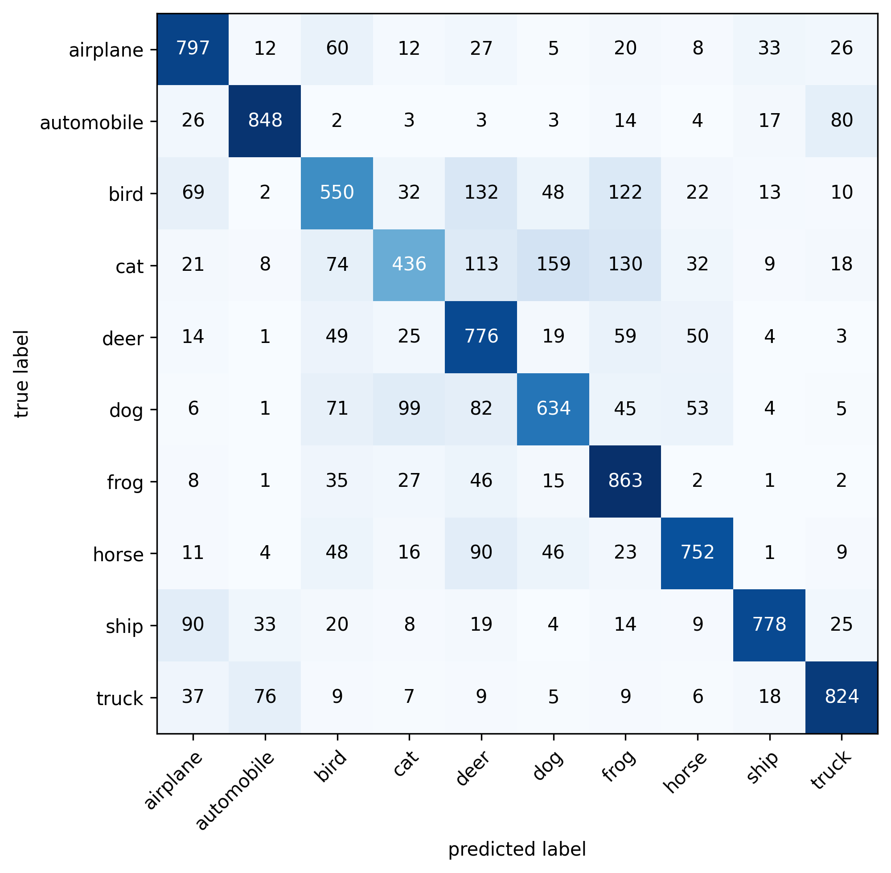

# CIFAR-10 Neural Network Classification

I started this project with a plain linear model on CIFAR-10 and slowly worked my way up to a CNN, trying out different architectures, data augmentations, optimizers and learning rate schedulers along the way.

Once I had a model that classified clean images well, I wanted to know how easily it could be fooled. That led me to FGSM and PGD attacks, and then to FGSM and PGD adversarial training to make the model more robust.

The main aim was not just to get a good accuracy, but to understand how these models behave and what actually makes them more robust.

## Results at a glance

| Experiment | Test Accuracy |
|---|---:|
| Final clean CNN | **91.89%** |
| Clean CNN under FGSM (8/255) | 8.39% |
| Clean CNN under PGD-10 (8/255) | 0.00% |
| FGSM-trained CNN under PGD-10 (8/255) | 31.33% |
| PGD-10-trained CNN under PGD-10 (8/255) | **40.31%** |

PGD adversarial training took the model from 0% to 40.31% under the PGD attack I tested, at the cost of some clean accuracy (91.89% down to 81.59%).

*Note: these are results from my own experiments, not a worst-case robustness guarantee. My PGD evaluation uses 10 iterations with random initialization, a single run, and no random restarts. All numbers are from a single training run, without averaging over seeds.*

### A note on hardware and reproducibility

All the results, especially the training times, are based on my own hardware (listed at the end). Timings will be different on different hardware. This could also change which models turn out best, because I picked my final models using the timings I got on my machine.

I have tried to make the program as reproducible as possible, but with so much randomness involved (augmentations, random initialization, PGD, and so on), the numbers you get might not match mine exactly. The overall conclusions (for example, the clean model failing under attack and adversarial training improving robustness) should hold, but small differences, like the one between PGD-10 and PGD-15 training, may not.

---

## 1. The Dataset

CIFAR-10 has 60,000 colour images of size 32 × 32 across 10 classes (6,000 per class): 50,000 for training and 10,000 for testing. I loaded it with `torchvision.datasets` and plotted a few images with Matplotlib before building anything.

## 2. Starting Simple

### 2.1 Linear model
My baseline was a model with only linear layers and no activation functions. The accuracy was low, which makes sense: a stack of linear layers is still just one linear transformation, and it can't pick up the non-linear patterns in images.

### 2.2 Adding non-linearity
I added activation functions and raised the epochs from 3 to 10. Accuracy improved noticeably.

### 2.3 First CNN
Since the fully connected models were still not good enough, I moved to convolutional layers. I tried different numbers of conv layers and hidden units, and the CNN was a big jump over the earlier models.

It also overfit: training accuracy was well above testing accuracy. The confusion matrix showed where it struggled, mostly between visually similar classes like cats and dogs, and automobiles and trucks.

| Model | Training Accuracy | Testing Accuracy |
|---|---:|---:|
| Linear Model | 39.46% | 36.88% |
| Linear + Non-Linear | 48.30% | 45.85% |
| Initial CNN | 81.00% | 73.40% |

These are from the early architecture experiments, before any of the improvements below.

<!-- TODO: embed your confusion matrix image here, e.g.
 -->

## 3. Fighting Overfitting

The initial CNN had a 7.6 point gap between training and testing accuracy (81.00% vs 73.40%), so my next goal was to close it. I added Batch Normalization and Dropout, and then spent a good amount of time on data augmentation, which shows the model different versions of the same image.

**RandomHorizontalFlip + RandomCrop** (with padding so the image size stays the same) gave a big improvement straight away. `ColorJitter` didn't do as well as this pair.

**TrivialAugmentWide** did worse than flip + crop, so I dropped it.

**RandomErasing** helped. Forcing the model to work with part of an image seems to stop it leaning on one region. Flip + crop + erasing was my best combination at this point.

**CutMix** did not help, and the model had a harder time learning with it. **MixUp** was worse than CutMix, and CutMix + MixUp together was worse still. I left all of them out.

**RandAugment** made no big difference when I tested it on its own. I kept it and tested it together with the other changes and the longer training schedule, so I can't say how much of the final improvement is down to RandAugment itself.

| Technique | Observation |
|---|---|
| RandomHorizontalFlip + RandomCrop | Significant improvement |
| ColorJitter | Not as good as flip + crop |
| TrivialAugmentWide | Lower than flip + crop |
| RandomErasing | Improved performance |
| CutMix | Reduced test performance |
| MixUp | Worse than CutMix |
| CutMix + MixUp | Worse than either alone |
| RandAugment | No major standalone improvement |

Because I changed several things between experiments, I can't separate how much each one contributed to reducing overfitting.

## 4. Schedulers, Optimizers and the Final Clean Model

Next I tried to see if changing the learning rate during training, or switching optimizer, could push things further. I split the 50,000 training images into 45,000 for training and 5,000 for validation, used the validation set to compare configurations, and kept the test set untouched for the final evaluation.

I tried `StepLR`, `ReduceLROnPlateau` and `CosineAnnealingLR`. I also tried AdamW, which applies weight decay separately from the gradient update instead of folding it into the loss like L2 regularization. AdamW with CosineAnnealingLR worked best for me.

### Final architecture
- 3 convolutional blocks, each with 3 conv layers (3 × 3 kernels with padding)
- Channels increase block by block: 64 → 128 → 256
- Batch Normalization and ReLU in the conv blocks, followed by Max Pooling
- Dropout (p = 0.2) in the classifier

### Final augmentation pipeline
1. RandAugment (`num_ops=2`, `magnitude=2`)
2. RandomHorizontalFlip
3. RandomCrop (`padding=3`)
4. RandomErasing (`p=0.3`)

Inputs are normalized with the CIFAR-10 channel means and standard deviations.

### Training configuration

| Parameter | Value |
|---|---|
| Optimizer | AdamW |
| Initial learning rate | 0.001 |
| Weight decay | 0.0005 |
| Scheduler | CosineAnnealingLR |
| Epochs | 30 |
| Batch size | 128 |
| Train / Validation / Test | 45,000 / 5,000 / 10,000 |

I kept the checkpoint with the lowest validation loss. It reached a clean test accuracy of **91.89%** with a test loss of **0.2703**, the best clean result in the project.

<!-- TODO (optional): add the final model's training accuracy here so the train/test gap is visible, e.g.
"Final model: train XX.XX% vs test 91.89%." -->

## 5. Attacking the Model

A high clean accuracy says nothing about what happens when the input is slightly changed. Adversarial attacks add small perturbations that are hard to see but can still make the model predict the wrong class. I implemented two of them, following Madry et al. for the PGD side:

[Towards Deep Learning Models Resistant to Adversarial Attacks – Madry et al. (2018)](https://arxiv.org/abs/1706.06083)

### 5.1 FGSM
FGSM takes one step in the direction that increases the loss, using the sign of the gradient with respect to the input:

\[
x_{adv}=x+\epsilon\cdot\text{sign}(\nabla_x J(\theta,x,y))
\]

where \(x\) is the original image, \(\epsilon\) controls the size of the perturbation, and \(J\) is the loss. I implemented it with PyTorch autograd. With \(\epsilon = 0\) the model behaves exactly as on clean images, and accuracy drops as \(\epsilon\) grows. The perturbed images look almost the same to me, yet the model misclassifies them.

### 5.2 PGD
PGD is the iterative version: random initialization, several small gradient steps, and a projection after each step so the perturbation stays within the \(\epsilon\) limit. For my epsilon experiments I used 10 iterations with step size

\[
\alpha=\frac{\epsilon}{4}
\]

which is 2/255 for the main 8/255 comparison. I also tried more iterations to see if the attack would get stronger.

### 5.3 FGSM vs PGD
Under the configurations I tested, PGD was clearly stronger: the loss went up much more at higher epsilons and accuracy dropped further.

| Evaluation (clean model) | Test Accuracy | Test Loss |
|---|---:|---:|
| Clean images | 91.89% | 0.2703 |
| FGSM (8/255) | 8.39% | 9.3832 |
| PGD-10 (8/255) | 0.00% | 48.4285 |

Going from 91.89% to 0.00% with perturbations I can barely see was the clearest sign to me that clean accuracy and robustness are two different things.

<!-- TODO: embed your FGSM / PGD example images here, e.g.
 -->

**Limitation:** this PGD result comes from a 10-step attack with random initialization and one evaluation run. Multiple restarts and stronger evaluations like AutoAttack would give a more reliable picture.

## 6. Adversarial Training

To see if I could make the model more robust, I trained it on adversarial images generated during training. I used the same 45,000 / 5,000 / 10,000 split as before, with the validation set used during training and the test set kept for evaluation.

<!-- TODO: state the epochs and learning rate used for adversarial training, or write
"same configuration as the clean model" if that's the case. -->

### 6.1 FGSM adversarial training
I tried perturbing all batches, 50% of them and 25% of them. Perturbing 50% gave the best balance of training time and robustness: 25% wasn't strong enough, and perturbing everything took much longer without a matching gain. I used ε = 8/255, since smaller values didn't give enough robustness and larger ones made training harder for my model.

### 6.2 PGD adversarial training
Same idea, with randomly initialized PGD perturbations: 50% of batches, ε = 8/255, 10 PGD iterations for the main model (I tried 15 later, see Section 7).

### 6.3 Comparison

| Model | Clean Accuracy | FGSM Accuracy | PGD-10 Accuracy |
|---|---:|---:|---:|
| Clean CNN | 91.89% | 8.39% | 0.00% |
| FGSM-Trained CNN | 83.48% | 44.36% | 31.33% |
| PGD-10-Trained CNN | 81.59% | 46.70% | 40.31% |

Both adversarially trained models lost clean accuracy but became far more robust, and the PGD-trained model beat the FGSM-trained one against both attacks. This is the trade-off between clean accuracy and robustness.

## 7. Does More PGD Training Help?

I trained another model with 15 PGD iterations and evaluated both models with PGD-10, 20 and 50 at ε = 8/255.

| Training Model | PGD-10 | PGD-20 | PGD-50 |
|---|---:|---:|---:|
| PGD-10 Trained | 40.21% | 39.05% | 38.88% |
| PGD-15 Trained | 40.55% | 39.64% | 39.43% |

PGD-15 was slightly better everywhere, by less than 1 percentage point, but it took more than 1000 extra seconds to train. I stayed with PGD-10 as my final robust model.

*Note on the numbers:* the PGD-10-trained model scores 40.31% in the main comparison and 40.21% here. PGD starts from a random initialization, so the exact accuracy varies a little between evaluation runs.

## 8. PGD-Trained Model at Different Epsilons

I also checked how the final PGD-10-trained model holds up as the attack gets stronger (PGD-10 attacks):

| Epsilon | Test Accuracy | Test Loss |
|---|---:|---:|
| 2/255 | 72.94% | 0.7719 |
| 4/255 | 62.39% | 0.9938 |
| 8/255 | 40.31% | 1.5957 |

Accuracy falls as epsilon grows, as you'd expect. Still, at 8/255 the model keeps 40.31%, compared with 0% for the clean model under the same attack.

<!-- TODO (optional): add an accuracy-vs-epsilon line chart here. -->

## 9. Takeaways

- CNNs were a big step up from the linear models, and augmentation (flip, crop, erasing) did a lot of the work in reducing overfitting. CutMix and MixUp didn't help my model.
- AdamW with CosineAnnealingLR gave me the best clean model: 91.89%.
- That same model dropped to 8.39% under FGSM and 0.00% under PGD.
- Adversarial training fixed a lot of that (40.31% under PGD), but it cost about 10 points of clean accuracy. PGD training beat FGSM training, and going from 10 to 15 PGD iterations wasn't worth the extra time.

## 10. What I Want to Try Next

- Stronger evaluation: multiple random restarts, and AutoAttack
- More epsilon values, step sizes and PGD iteration counts
- TRADES, compared against standard PGD adversarial training
- Looking more closely at the accuracy vs robustness trade-off
- Larger architectures and datasets, once I have the compute

---

## How to Run

**Requirements:** Python, PyTorch, Torchvision, NumPy, Pandas, Matplotlib, Seaborn, Scikit-learn, TorchMetrics, mlxtend.

```bash
git clone https://github.com/PranavAgrawal07/CIFAR-10-Neural-Network-Classification.git
cd CIFAR-10-Neural-Network-Classification
pip install torch torchvision numpy pandas matplotlib seaborn scikit-learn torchmetrics mlxtend
```

For GPU support, install a PyTorch build that matches your CUDA version from the [official PyTorch guide](https://pytorch.org/get-started/locally/). I used an Anaconda environment, but a normal `pip` setup works too.

Then start Jupyter, open `CIFAR-10_Neural_Network_Classification.ipynb` and run the cells in order. CIFAR-10 downloads automatically. PGD adversarial training takes a long time, so a CUDA GPU is recommended.

## Project Structure

```text
CIFAR-10-Neural-Network-Classification/
│
├── CIFAR-10_Neural_Network_Classification.ipynb
│
├── Plot_images/
│   ├── FGSM/
│   ├── PGD/
│   └── Comparison_PGD_FGSM/
│
├── models/
│   ├── best_model.pth
│   └── Best_Robust_Model.pth
│
└── README.md
```

The notebook has the full implementation and experiments, `Plot_images` has the visualisations, and `models` has the saved weights. Other files may be present in the repository.

## Hardware and Software

| Component | Details |
|---|---|
| CPU | AMD Ryzen 7 7445HS |
| GPU | NVIDIA RTX 4050 Laptop GPU (6 GB VRAM) |
| RAM | 16 GB |
| Python | Python 3 (Anaconda environment) |
| PyTorch | 2.5.1 with CUDA 11.8 |

---

This project helped me understand how to build and improve a CNN, and also how fragile it can be, and how adversarial training can make it harder to fool.
